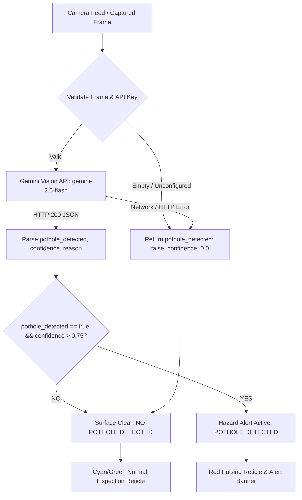

# Phase 1 Plan: AI Vision Pothole Verification & Camera Detection Pipeline

## 🎯 Goal
Eliminate false-positive pothole detections by replacing hardcoded/static default states with an authenticated Gemini Vision inspection pipeline (`gemini-2.5-flash`), enforcing strict verification rules, confidence threshold gating (> 0.75), fail-safe error handling, and a dynamic HUD displaying both "Pothole Detected" and "No Pothole Detected" states.

---

## 🔍 Root Cause Analysis & Problem Statement
1. **Initial State Misconfiguration:** `AppState._hazardDetected` initializes to `true` by default, prematurely alerting users before any camera frame is evaluated.
2. **Unconditional Overlay Rendering:** `CameraScreen` renders `_buildHazardOverlay` directly inside `if (appState.isAiDetectionEnabled)`, presenting an alert bounding box even when pointing at indoor surfaces or normal asphalt.
3. **Pothole-Biased Fallback:** `GeminiRoadService._buildFallbackEvaluation` defaults to `isRoadAlright: false` with an urgent "Pothole Cavity", causing any network timeout or missing API key to trigger a false alert.
4. **Missing Verification Contract:** The API prompt lacked strict pothole verification rules and structured schema (`pothole_detected`, `confidence`, `reason`).
5. **No Confidence Gating:** The system lacked threshold enforcement (`confidence > 0.75`) and a dedicated "No Pothole Detected / Surface Clear" reticle.
6. **UI Overflow:** The top control bar in `CameraScreen` exceeds screen boundary by 27px on standard devices.

---

## 📋 Requirements & Specifications

### 1. Gemini Vision Model & Endpoint Configuration
- Configure `gemini-2.5-flash` in `GeminiConfig` as the primary vision evaluation model.
- Support runtime API key retrieval via `--dart-define=GEMINI_API_KEY=...` or runtime user input.

### 2. Strict Verification Prompt & Structured JSON Output
- Gemini Prompt Rules:
  1. Return `pothole_detected: true` ONLY if there is a visible structural cavity, bowl-shaped depression, or broken chunk missing from the road surface.
  2. Return `false` for normal pavement, shadows, tire marks, oil stains, manhole covers, speed bumps, shallow surface cracks, or non-road images.
  3. If blurry, dark, or obstructed, return `false`.
- Structured JSON Schema:
  ```json
  {
    "pothole_detected": boolean,
    "confidence": number, // between 0.0 and 1.0
    "reason": string
  }
  ```
- Use Gemini API `generationConfig.responseMimeType = "application/json"`.

### 3. Threshold & State Machine Logic
- Trigger "Pothole Detected" alert UI ONLY when:
  `pothole_detected == true` AND `confidence > 0.75`.
- In all other scenarios (`pothole_detected == false` OR `confidence <= 0.75`):
  - Set `hazardDetected = false`.
  - Display "No Pothole Detected" / "Surface Clear" state in green/neutral styling.
- Display "Scanning / Evaluating..." state during active Gemini analysis.

### 4. Fail-Safe Error Handling Invariant
- Missing API key: Returns `{ pothole_detected: false, confidence: 0.0, reason: "API key not configured" }`.
- Network timeout / HTTP error: Returns `{ pothole_detected: false, confidence: 0.0, reason: "Connection failed" }`.
- Corrupt/Empty image: Returns `{ pothole_detected: false, confidence: 0.0, reason: "Invalid image data" }`.
- **Invariant:** Errors NEVER trigger a hazard alert or default to "Pothole Detected".

### 5. UI Layout Fix
- Resolve the `RIGHT OVERFLOWED BY 27 PI` in `CameraScreen` top control bar by using responsive wrapping/flex layout.

---

## 🏗️ Architecture & Data Flow



---

## 🛠️ Step-by-Step Task Breakdown

### Wave 1: Core Service & Data Model (Atomic)
- [ ] **Task 1.1: Update Gemini Configuration**
  - Add `gemini-2.5-flash` model identifier to `lib/config/gemini_config.dart`.
  - Maintain support for runtime overrides.
- [ ] **Task 1.2: Implement `PotholeVerificationResult` Model**
  - Create model with fields: `potholeDetected` (bool), `confidence` (double), `reason` (string), `analyzedAt` (DateTime).
  - Add JSON serialization/deserialization with safe fallback parsing.
- [ ] **Task 1.3: Update `GeminiRoadService` Vision API Call**
  - Implement `verifyPotholeInImage(Uint8List bytes)` method targeting `gemini-2.5-flash`.
  - Inject the strict 3-rule verification system prompt with JSON response enforcement.
  - Implement fail-safe error handling returning `pothole_detected: false` on network error, invalid status, or missing key.

### Wave 2: Application State & Gating Logic (Atomic)
- [ ] **Task 2.1: Fix Initial State in `AppState`**
  - Change default `_hazardDetected = false;` (was previously `true`).
  - Add `PotholeVerificationResult? _lastVerificationResult`.
  - Add getter `PotholeVerificationResult? get lastVerificationResult`.
- [ ] **Task 2.2: Implement Evaluator Gating in `AppState`**
  - Update `evaluateCurrentPhotoWithGemini` to call `verifyPotholeInImage`.
  - Gating logic:
    ```dart
    final isVerifiedHazard = result.potholeDetected && result.confidence > 0.75;
    _hazardDetected = isVerifiedHazard;
    ```
  - Ensure `_isEvaluatingWithGemini` cleanly notifies listeners on start and completion.

### Wave 3: Camera Screen UI & Layout Polish (Atomic)
- [ ] **Task 3.1: Fix Layout Overflow in `_buildCameraAccessControlBar`**
  - Replace rigid `Row` + `Spacer` with a responsive or flexible layout to eliminate the 27px right overflow.
- [ ] **Task 3.2: Implement Dual-State Viewfinder HUD**
  - State A (Evaluating): Display animated scanning radar with "Analyzing Road Surface with Gemini 2.5 Flash...".
  - State B (Verified Hazard: `hazardDetected == true`): Display red alert banner `Pothole Detected (High Severity)` and confidence percentage.
  - State C (Clear: `hazardDetected == false`): Display clean cyan/green reticle with `NO POTHOLE DETECTED (Confidence: X%)` and short reason.
- [ ] **Task 3.3: Fix HUD Text Overlap**
  - Resolve visual overlap between "AI Scanning" badge and "Hazard Detection Active" indicator.

### Wave 4: Automated Verification & Unit Tests (Atomic)
- [ ] **Task 4.1: Unit Tests for `PotholeVerificationResult` & Threshold Gating**
  - Verify JSON parsing with valid, malformed, and edge-case responses.
  - Verify threshold boundaries: `confidence: 0.75` (false), `confidence: 0.76` (true when `pothole_detected` is true).
- [ ] **Task 4.2: Fail-Safe Error Handling Tests**
  - Verify missing API key returns `pothole_detected: false` and `hazardDetected == false`.
  - Verify network failure returns `pothole_detected: false` without throwing unhandled exceptions.
  - Verify non-road / indoor image returns `pothole_detected: false`.
- [ ] **Task 4.3: Widget Tests for Camera Screen Dual-State Rendering**
  - Test that default initial state renders "No Pothole Detected / Surface Clear".
  - Test that verified pothole (`true`, `0.85`) switches UI to "Pothole Detected".
  - Run full test suite (`flutter test`) and ensure 100% pass rate.

---

## 🧪 Acceptance Criteria
1. When the app launches or camera feed starts, the camera HUD does **NOT** default to "Pothole Detected".
2. When capturing non-road scenes (e.g., indoor surfaces, floors, shadows), Gemini returns `pothole_detected: false` and the UI shows "No Pothole Detected".
3. When capturing a real structural pothole and Gemini returns `pothole_detected: true` with `confidence > 0.75`, the UI immediately triggers the red alert banner and hazard state.
4. If network is disconnected or API key is absent, the system displays an informative status and defaults to safe non-hazard state (`hazardDetected: false`).
5. The 27px layout overflow warning on the Camera Screen is eliminated.
6. All `flutter test` automated tests pass.
